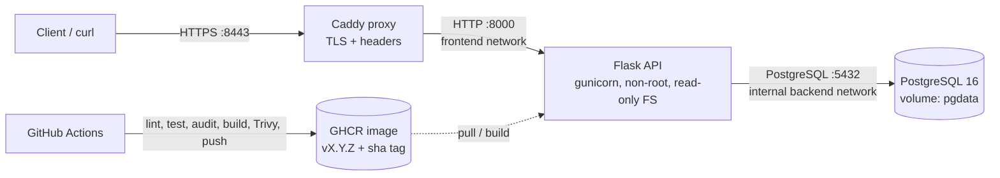

# School Management Platform - Cloud Deployment & CI/CD

A small **Student / Class / Attendance API** (Flask + PostgreSQL) whose real purpose is to demonstrate
a reproducible build, secure container, CI pipeline, HTTPS reverse proxy, observability,
backup/restore and rollback. It deliberately is *not* a school ERP.

> Assessment: ALGIONS AI LABS - DevOps & Cloud Engineering. All data is synthetic.

## Architecture



Only the proxy publishes ports. The database sits on an `internal` Docker network with no route out.

## Quick start (clean machine: Docker + Compose v2)

```bash
git clone <your-repo-url> && cd school-platform
cp .env.example .env            # then edit: set POSTGRES_PASSWORD, JWT_SECRET, SEED_PASSWORD
docker compose up -d --build
scripts/smoke_test.sh           # end-to-end checks incl. the role/duplicate rules
curl -k https://localhost:8443/ready
```

`-k` is needed because Caddy issues a certificate from its own local CA (`tls internal`).
For a real domain, set `SITE_ADDRESS=your.domain` and Caddy obtains a Let's Encrypt certificate.

### Environment variables

| Variable | Purpose | Default |
|---|---|---|
| `POSTGRES_DB` / `POSTGRES_USER` / `POSTGRES_PASSWORD` | Database credentials (password: letters/digits only) | required |
| `JWT_SECRET` | Token signing key, min 16 chars (use 32+) | required |
| `SEED_PASSWORD` | Password for the synthetic demo users | required if seeding |
| `SEED_ON_START` | Seed demo data when DB is empty | `true` |
| `LOG_LEVEL` | `DEBUG`/`INFO`/`WARNING` | `INFO` |
| `APP_TAG` | Image tag deployed (managed by `release.sh` / `rollback.sh`) | `dev` |
| `HTTPS_PORT` / `HTTP_PORT` | Host ports for the proxy | `8443` / `8080` |
| `SITE_ADDRESS` | Hostname Caddy serves | `localhost` |

### Port map

| Service | Container port | Host port | Exposed? |
|---|---|---|---|
| proxy (Caddy) | 443 / 80 | 8443 / 8080 | yes |
| app (gunicorn) | 8000 | - | frontend network only |
| db (PostgreSQL) | 5432 | - | internal backend network only |

## API

| Method & path | Auth | Description |
|---|---|---|
| `GET /health` | none | Liveness (process is up) |
| `GET /ready` | none | Readiness (database reachable) - 503 if not |
| `GET /metrics` | none | Prometheus-style request counters (per worker) |
| `POST /auth/login` | none | `{username,password}` -> JWT |
| `GET /classes` | any user | Classes with teacher and student count |
| `GET /classes/<id>/students` | any user | Students assigned to a class |
| `POST /classes/<id>/attendance` | **assigned teacher only** | `{student_id, date?, session?, status?}` |
| `GET /classes/<id>/attendance?date=` | assigned teacher / admin | Attendance records |
| `GET /audit-log` | admin | Latest audit entries |

Attendance rules: non-teachers -> `403`; teacher not assigned to the class -> `403`; student not enrolled
in the class -> `422`; same student/class/date/session twice -> `409`. Every write attempt (allowed,
denied or rejected) is written to the audit log. Sessions: `morning|afternoon`; statuses:
`present|absent|late`.

Seed users (all use `SEED_PASSWORD`): `admin`, `teacher1` (classes 1 & 3), `teacher2` (class 2), `student1`.

## Development and tests

```bash
python -m venv .venv && source .venv/bin/activate
make install
make test          # 17 API tests (SQLite, no Docker needed)
make fmt && make lint
```

## CI/CD (`.github/workflows/ci.yml`)

On every PR and push: `ruff check`, `ruff format --check`, unit tests, `pip-audit`.
On push to `main` additionally: build image -> **Trivy** scan (fails on fixable CRITICAL) -> push to
GHCR as `ghcr.io/<owner>/<repo>:v<VERSION>` and `:sha-<commit>`; the digest is printed in the run summary.
The workflow uses least-privilege `permissions` and only the built-in `GITHUB_TOKEN` - no stored secrets.
Bump `VERSION` to cut a new release tag.

## Releasing and rolling back

```bash
scripts/release.sh v1.0.1     # builds, tags school-api:v1.0.1, deploys, waits for /ready
scripts/rollback.sh           # back to the previous tag recorded in .releases
scripts/rollback.sh v1.0.0    # or a specific tag
```

Rollback recreates only the `app` container from the older image; the database volume is untouched.
If a release changed the schema destructively, also restore a pre-release backup (see runbook).

## Backup, restore, failure drills

```bash
scripts/backup.sh                          # -> backups/school_<UTC>.dump
scripts/restore.sh backups/school_X.dump   # stops app, restores, restarts, prints row counts
scripts/drill_failure.sh                   # stops DB -> /ready 503 -> recover; kills app -> restarts
```

See [docs/RUNBOOK.md](docs/RUNBOOK.md) for incident response and [docs/EVIDENCE.md](docs/EVIDENCE.md)
for the evidence checklist.

## Security notes

Non-root container user, read-only root filesystem, all Linux capabilities dropped, `no-new-privileges`,
multi-stage build with pinned dependencies, secrets only via environment (`.env` is git-ignored; only
`.env.example` is committed), database not reachable from outside, HSTS and `nosniff` headers,
JWT-based role checks on every write endpoint, dependency + image scanning in CI.

## Known limitations / assumptions

- Demo user accounts are seeded; there is no user-management API.
- `/metrics` counters are per gunicorn worker (not aggregated).
- TLS uses Caddy's internal CA locally; browsers warn until the CA is trusted.
- Secrets live in a local `.env`; production would use a secret manager (Vault, AWS/GCP Secret Manager).
- Single-host deployment: no HA, no automated off-host backups.
